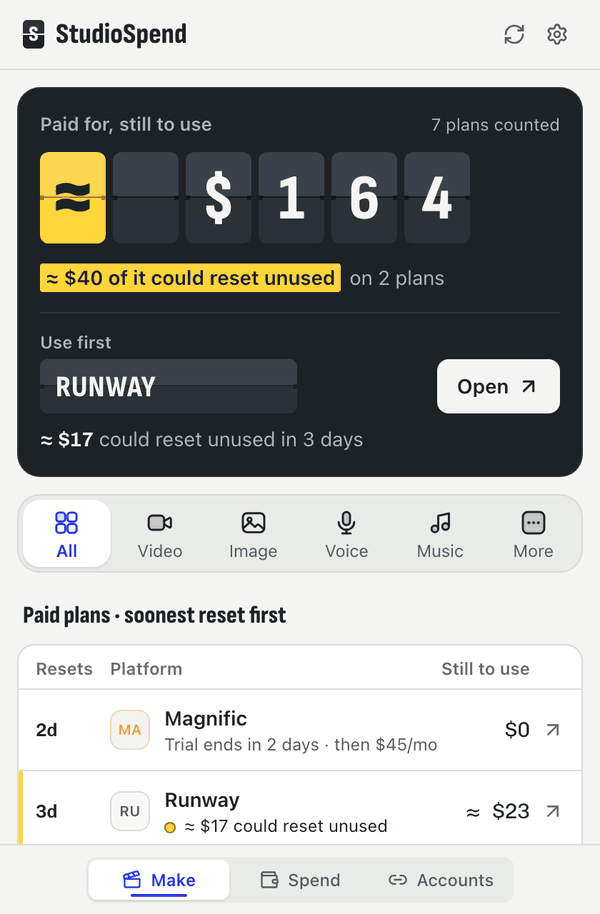
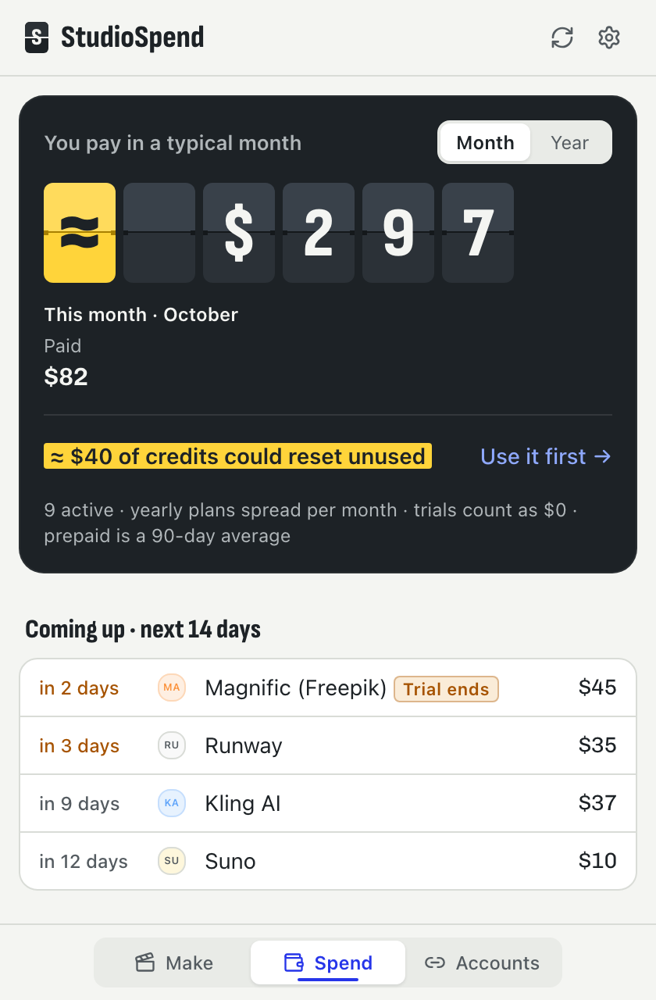
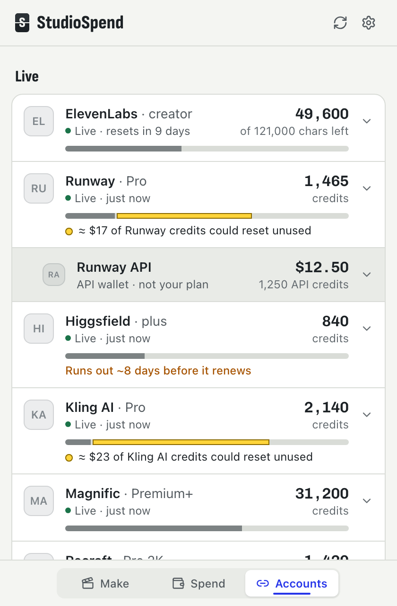

  

<h1 align="center">StudioSpend</h1>

  <b>What you pay. What’s left. Where to make next.</b> 
  The menu-bar app for Mac that keeps your creative-AI subscriptions straight.

  <a href="https://github.com/lithopoint/studiospend-public/releases/latest/download/StudioSpend-macOS.dmg"><picture>
    <source media="(prefers-color-scheme: dark)" srcset="assets/download-dark.png">
    
  </picture></a>

  Free for 30 days, no card and no account · then $5 a month or $45 a year Apple silicon and Intel in one download · tested on macOS 26 (Tahoe)

  <a href="CHANGELOG.md">What’s new</a> &nbsp;·&nbsp;
  <a href="docs/faq.md">FAQ</a> &nbsp;·&nbsp;
  <a href="docs/privacy.md">Privacy</a> &nbsp;·&nbsp;
  <a href="SUPPORT.md">Get help</a>

 

  <picture>
    <source media="(prefers-color-scheme: dark)" srcset="assets/hero-dark.gif">
    
  </picture>

Sample data. Platform logos are replaced by initials.

 

You pay for five, ten, maybe fifteen creative-AI tools. Each has its own credits, its own renewal date and its own idea of what a credit is. **StudioSpend** adds it all up, shows what is left on each plan in things you can picture, like “about 40 videos”, and tells you where to make your next video, image or track so the credits that are about to expire get used first.

## What it does

<table>
  <tr>
    <td width="300" align="center">
      <picture>
        <source media="(prefers-color-scheme: dark)" srcset="assets/shots/make-job-dark.png">
        
      </picture>
    </td>
    <td>
      <h3>Make</h3>
      
What your plans can still make, in dollars and in jobs. One platform to use first, with the reason in a sentence: credits that reset soon, then unlimited modes, then the cheapest.

      
Pick a job (video, image, voice-over, music and more) and see what one costs on each plan you pay for.

    </td>
  </tr>
</table>

<table>
  <tr>
    <td width="300" align="center">
      <picture>
        <source media="(prefers-color-scheme: dark)" srcset="assets/shots/spend-dark.png">
        
      </picture>
    </td>
    <td>
      <h3>Spend</h3>
      
Every plan, what it costs per month and per year, and what renews or ends its trial next.

      
Drop in a bank or card statement (CSV, OFX or QFX) and StudioSpend finds your creative-AI charges, including the platforms that have no connection at all. It also points out a smaller plan that would still cover you.

    </td>
  </tr>
</table>

<table>
  <tr>
    <td width="300" align="center">
      <picture>
        <source media="(prefers-color-scheme: dark)" srcset="assets/shots/credits-dark.png">
        
      </picture>
    </td>
    <td>
      <h3>Accounts</h3>
      
Live balances from the platforms you connect, through each platform’s own sign-in page. The yellow part of a bar is what could reset unused before the plan renews.

      
A developer API wallet is shown apart from the plan you pay for, so a balance never looks bigger than it is.

    </td>
  </tr>
</table>

### Also in the app

- **Alerts.** A Mac notification before credits reset unused, before a plan runs out early, before a renewal or a trial ends, and when you are on track to pass your monthly budget.
- **Ask Claude.** Add StudioSpend to Claude Desktop or Claude Code and ask where to make something. It answers from your own numbers and cannot change anything. [How to add it](docs/claude-connector.md).
- **Move to another Mac.** Your plans, payments and settings in one passphrase-locked file that you carry yourself.

## Private by design

- What you enter lives in a database **on your Mac**. There is no StudioSpend account and no analytics.
- You sign in on **each platform’s own sign-in page**. StudioSpend never sees your password, and the access it is granted stays in your Mac’s Keychain.
- StudioSpend only reads. It cannot generate anything, spend your credits or change a plan.
- Three things leave your Mac: balance requests to the platforms **you** connect, a license check, and a download of the public price table.

The full list, with where each file lives, is in [docs/privacy.md](docs/privacy.md).

## Install

1. Download **[StudioSpend-macOS.dmg](https://github.com/lithopoint/studiospend-public/releases/latest/download/StudioSpend-macOS.dmg)** and open it.
2. Drag **StudioSpend** into **Applications**.
3. Open it. StudioSpend lives in your menu bar and has no Dock icon: click its icon to open it.

The app is signed with an Apple Developer ID and notarized by Apple, so macOS opens it without a warning. To check the download yourself, compare it with [SHA256SUMS.txt](https://github.com/lithopoint/studiospend-public/releases/latest/download/SHA256SUMS.txt) ([how](docs/verify.md)).

**Requirements.** A Mac with Apple silicon or Intel. Tested on macOS 26 (Tahoe); older versions may work but have not been tested. Updating, first open and removing the app are covered in [docs/install.md](docs/install.md) and [docs/uninstall.md](docs/uninstall.md). Older versions are on the [releases page](https://github.com/lithopoint/studiospend-public/releases).

## Price

The first 30 days are free, with no card and no account. After that StudioSpend is **$5 a month** or **$45 a year**. If the trial ends before you decide, nothing is deleted: your data and the Spend tab stay.

## Platforms

**Connect and read your balance** (official sign-in or key): Runway, Higgsfield, Kling AI, Recraft, Magnific, OpenArt, ElevenLabs, VEED, Opus Clip, Mage.space, Playground, Black Forest Labs, Ideogram API, fal.ai, kie.ai, OpenRouter, Runware, Pollo AI, Atlas Cloud and 3D AI Studio.

**Track by hand or from a statement** (the platform offers no way to read a balance): Midjourney, Suno, Adobe Firefly, ChatGPT and more.

The list grows as platforms open up. StudioSpend is independent and is not affiliated with or endorsed by any of them. Product names belong to their owners and appear here only to say which services work with the app.

## Questions

<b>Do I have to connect my accounts?</b>

 
No. Type in what you pay for, or import a bank or card statement, and Spend works fully. Connecting a platform adds its live balance.

<b>Why can’t it read my Midjourney or Suno balance?</b>

 
Those platforms offer no official way for another app to read a balance. Enter the plan by hand or import a statement, and StudioSpend still tracks what you pay and when it renews.

<b>Why do numbers start with ≈?</b>

 
Platforms count credits differently, so StudioSpend turns them into jobs using a price table it publishes with sources and dates. A figure with ≈ is an estimate.

<b>Does it work on Windows?</b>

 
Not yet. StudioSpend is a Mac app for now.

More in the [FAQ](docs/faq.md).

## Help

- In the app: **Settings → Help & feedback**.
- Common problems: [FAQ](docs/faq.md) and [SUPPORT.md](SUPPORT.md).
- Security reports: [SECURITY.md](SECURITY.md).
- What changed in each version: [CHANGELOG.md](CHANGELOG.md).

## License

© 2026 LithoPoint LLC. All rights reserved. StudioSpend is proprietary software and its source code is not public. See [LICENSE](LICENSE).

---

<b>For developers: the files this repository hosts</b>

 

This repository also serves files to the app and to platforms through Cloudflare Pages at `https://files.studiospend.com/`. Those URLs are built into the app, so **never move or rename them**:

- `oauth/client-metadata.json`: the OAuth client metadata document platforms read to recognise StudioSpend when you sign in.
- `prices/v2.json`: the price table (plans, prices, credits per job), generated by the app’s publish script and never edited by hand. Installed apps refresh it about every 12 hours. `prices/v1.json` stays for older builds.
- `_headers`: Cloudflare caching rules.

The app’s source repository is private and is the source of truth for everything here. This repository is public, so nothing private goes in it.

